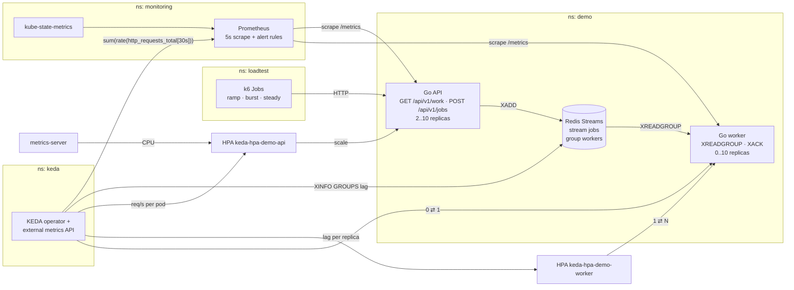
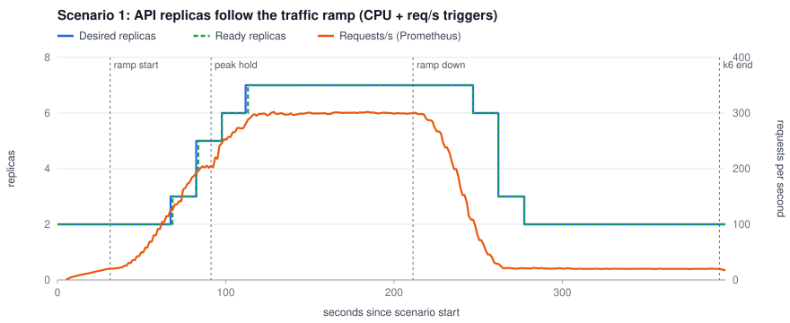
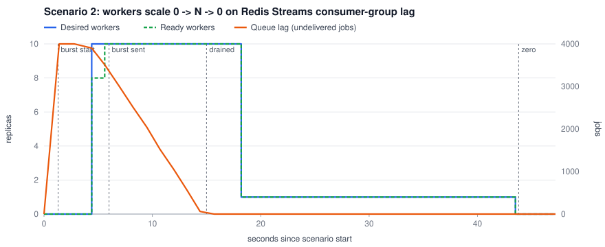
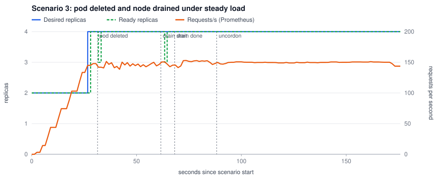

# k8s-event-driven-autoscaling

[](https://github.com/ahmedelgmal310/k8s-event-driven-autoscaling/actions/workflows/ci.yml)
[](LICENSE)

Kubernetes autoscaling that reacts to **real demand**, with the numbers to prove it.
**KEDA** scales a Go **HTTP API** on two signals, CPU and **requests/s per pod from Prometheus**.
It also scales a Go **queue worker** on **Redis Streams consumer-group lag**, all the way **down
to zero** when the queue is idle and back up when jobs arrive.

Every push to `main` re-proves this on a throwaway 5-node **kind** cluster with **k6** load tests.
These tests are gates, not demos. The job fails if a request fails during scale-out, scale-in,
a pod kill or a node drain. It also fails if p95 latency breaks the SLO, if the workers do not
drain the queue in time, or if they do not go back to zero.

## Contents

- [The problem](#the-problem)
- [Architecture](#architecture)
- [How it works](#how-it-works)
- [Results from CI](#results-from-ci)
- [Zero-downtime scaling: what makes it work](#zero-downtime-scaling-what-makes-it-work)
- [Alerts](#alerts)
- [Supply chain and quality gates](#supply-chain-and-quality-gates)
- [Runbook](#runbook)
- [Tuning guide](#tuning-guide)
- [Limitations](#limitations)
- [Repository layout](#repository-layout)
- [Local development](#local-development)

## The problem

A default HPA on CPU alone fits these workloads poorly:

- **Request-driven services** often run out of headroom before CPU shows it (I/O waits, connection
  limits). A request-rate target scales on the thing users feel. CPU stays as a backstop for
  expensive requests.
- **Queue consumers** should follow the **backlog**, not their own CPU. A worker sitting at 0%
  CPU with 4,000 jobs waiting needs more replicas, not fewer. An idle queue should cost
  **zero pods**. A plain HPA cannot do either, because it cannot go below 1 replica or read a queue.
- **Scaling must be invisible to users.** Each scale-in, rollout and node drain kills pods. Without
  readiness gating, a preStop delay, graceful drain and disruption budgets, every scaling event
  becomes a burst of 502s.

This repository builds all of that and **measures it**: replicas over time, time to scale, and
latency and errors while scaling.

## Architecture



The e2e cluster has 1 control plane node, 1 `infra` node (KEDA, Prometheus, metrics-server, Redis,
k6) and 3 `app` nodes labelled `zone-a`, `zone-b` and `zone-c`. Pinning the platform to its own
node means a node drain tests the application, not the load generator.

## How it works

**The API** ([`cmd/api`](cmd/api), [`internal/api`](internal/api)) is the Go stdlib plus the
Prometheus client. `GET /api/v1/work` burns a fixed, configurable amount of CPU (chained SHA-256
rounds), so the CPU cost per request is a known number. `POST /api/v1/jobs` appends a job to the
stream. `GET /api/v1/queue` reports lag, pending and processed counts. `/readyz` turns to 503 as
soon as shutdown starts. The API exports `http_requests_total`, a latency histogram and queue
gauges.

**The worker** ([`cmd/worker`](cmd/worker), [`internal/worker`](internal/worker)) reads with
`XREADGROUP` (one job per read, `CONCURRENCY` loops per pod). It acknowledges each job with `XACK`
and increments a processed counter in the same `MULTI`. Every 15s it runs `XAUTOCLAIM` to take
over jobs that a crashed pod left unacknowledged for more than 60s. On SIGTERM it stops reading,
finishes and acknowledges every job in flight, then removes its consumer from the group. It only
does that if the consumer owns no pending entries, because deleting a consumer with pending entries
would drop them.

**Why Redis Streams.** On kind it is the most reliable choice: a single small pod that is ready
in about a second. Consumer groups give at-least-once delivery with acknowledgements. KEDA's
`redis-streams` scaler can read the group **lag** (`XINFO GROUPS`, Redis 7+). Lag is the only
Redis Streams metric that supports scaling **to and from zero**. Pending entries need a consumer
to exist, and stream length never drops if you keep history. RabbitMQ and NATS JetStream would
work too, but each adds a heavier broker to start and wait on in CI.

**Two ScaledObjects** ([`charts/event-autoscaling/templates/scaledobjects.yaml`](charts/event-autoscaling/templates/scaledobjects.yaml)):

| | API | Worker |
|---|---|---|
| Triggers | `cpu` Utilization 70% of the request, **and** `prometheus` AverageValue 40 req/s per pod | `redis-streams` `lagCount: 50` per replica, `activationLagCount: 0` |
| Prometheus query | `sum(rate(http_requests_total{namespace="demo",pod=~"demo-api-.*",route=~"/api/v1/.*"}[30s]))` | n/a |
| Replicas (e2e) | 2 to 10 | **0** to 10 |
| Scale up (e2e) | +100% or +4 pods per 15s, no stabilization | +10 pods per 10s |
| Scale down (e2e) | −50% per 15s after a 30s stabilization window | −100% per 15s after 15s, then **0 after a 30s cooldown** |

KEDA creates and owns the HPAs. With two triggers, the HPA takes the **larger** desired count.
From zero, the KEDA operator itself moves the worker 0 → 1 on its polling interval, then the HPA
takes it from 1 to N. Production values ([`environments/prod`](environments/prod/values.yaml)) use
a minimum of 3 API replicas (one per zone), 30 to 40 replica ceilings, a managed Redis, and a slow
scale-in: a 10 minute stabilization window, −20% per 2 minutes, and a 10 minute worker cooldown.

## Results from CI

These numbers come from CI run
[#40608705499](https://github.com/ahmedelgmal310/k8s-event-driven-autoscaling/actions/runs/40608705499)
on `main`. Setup: kind v0.33.0 with 5 nodes, Kubernetes v1.36.4, KEDA 2.21.0, Prometheus with a 5s
scrape, and k6 running in the cluster. Requests are sized from the
[previous run's measurements](docs/tuning.md). Every run uploads its CSV time series, k6 summaries,
charts and `results.json` as the `e2e-results` artifact and posts the table to the job summary.

**SLO enforced by the k6 thresholds:** p95 < 250 ms **and zero failed requests** in every scenario.

### Scenario 1: traffic ramp (20 → 300 → 20 req/s)



| Metric | Measured |
|---|---|
| Requests / failed | **53,999 / 0** |
| Latency p50 / p95 / p99 / max | 0.49 ms / **0.70 ms** / 1.11 ms / 8.52 ms |
| API replicas | 2 → **7** → 2 |
| First scale-out after the ramp starts | **35.9 s** |
| All 7 replicas ready after the ramp starts | 81.9 s |
| First scale-in after the load drops / back to 2 replicas | 35.7 s / 66.1 s (still under load, 0 errors) |
| Peak HPA inputs | CPU 83% of request, 62.1 req/s per pod |
| API pods per zone at peak (topology spread) | 2 / 3 / 2 across the three app nodes (maxSkew 1) |

### Scenario 2: burst of 4,000 jobs into an idle queue (0 → N → 0)



| Metric | Measured |
|---|---|
| Jobs accepted / failed | **4,000 / 0** (sent in 1.0 s, p95 21.2 ms) |
| Workers before the burst | **0** |
| First worker scheduled / ready | 3.1 s / **3.1 s** after the burst starts |
| Peak workers / peak lag | **10** / 4,000 jobs |
| Queue drained (lag 0, pending 0, all 4,000 acknowledged) | **13.7 s** after the burst starts (target 120 s) |
| Back to **0 workers** after the drain | **28.9 s** (target 120 s; the cooldown is 30 s) |
| Duplicate deliveries | 0 |

### Scenario 3: pod deleted and node drained under steady load (150 req/s)



| Metric | Measured |
|---|---|
| Requests / failed | **25,501 / 0** |
| Latency p95 / max | **0.73 ms** / 14.9 ms |
| Disruptions | `kubectl delete pod` (SIGTERM) on one API pod, then `kubectl drain` of the app node running the most API pods (2) |
| Drain duration (evictions respect the PDB) | 6 s, never fewer than **2** ready API pods |

The job also checks that all **7/7** alert rules load and evaluate in Prometheus
(`health: ok`). It fails if any alert is *firing* after the scenarios, and it checks that
kube-state-metrics exports the KEDA HPA series the alerts use.

**What `e2e/run.sh` asserts** (any miss fails CI):

1. Both ScaledObjects are `Ready`, the API HPA reports both CPU and req/s, and the worker is at 0 replicas.
2. Ramp: 0 failed requests, p95 < 250 ms, the API peaks at ≥ 4 replicas, and scale-in starts while k6 is still sending load.
3. Burst: every submission returns 202, workers scale up from 0, and lag and pending reach 0 with every job acknowledged within 120 s.
   The workers then return to 0 replicas, with no worker pods left, within 120 s.
4. Disruption: 0 failed requests and p95 < 250 ms through the pod deletion and the drain, and the drain finishes within its timeout.
5. Alert rules are healthy and no alert is firing.

## Zero-downtime scaling: what makes it work

Scale-in, rollouts and drains all remove pods. Each step below closes a specific way a request
can fail:

| Mechanism | Where | Failure mode it prevents |
|---|---|---|
| Readiness probe on `/readyz` every 2s | API Deployment | New replicas get traffic only once they can serve it |
| Native `preStop: sleep: 5s` | API Deployment | Endpoint removal propagates to every node's kube-proxy *before* SIGTERM. Without it, new connections race to a closing socket |
| `/readyz` → 503 on SIGTERM, then `http.Server.Shutdown` (20s budget) | `cmd/api` | In-flight requests finish; no connection is cut mid-response |
| `terminationGracePeriodSeconds: 30` > preStop + drain | both | The kubelet never SIGKILLs a pod that is still draining |
| Worker drains in-flight jobs, acks, then deregisters | `internal/worker` | Scale-in and scale-to-zero never abandon a job that was already read |
| `XAUTOCLAIM` after 60s idle | `internal/worker` | A crashed worker's jobs are redelivered, not lost |
| `PodDisruptionBudget maxUnavailable: 1` | both | A drain evicts one API pod at a time. `maxUnavailable` (not `minAvailable`) so the budget never blocks scale to zero |
| `unhealthyPodEvictionPolicy: AlwaysAllow` | both PDBs | A crash-looping pod cannot block a node drain |
| Topology spread on zone (`DoNotSchedule`) and node (`ScheduleAnyway`), `nodeTaintsPolicy: Honor`, `matchLabelKeys: [pod-template-hash]` | both | One zone or node loss removes only a share of capacity. A cordoned node is not counted, so a drain cannot deadlock placement |
| `maxUnavailable: 0` rolling updates | API | A rollout never drops below the current capacity |
| No CPU limit, memory limit set | both | No CFS throttling in the tail latency, memory stays bounded |

The k6 scripts use `noConnectionReuse`, so kube-proxy balances every request. With long-lived
keep-alive connections, new replicas would receive almost no traffic from existing clients (see
[Limitations](#limitations)).

## Alerts

Rules: [`charts/event-autoscaling/files/alerts.yaml`](charts/event-autoscaling/files/alerts.yaml).
Unit tests: [`tests/alerts/alerts_test.yaml`](tests/alerts/alerts_test.yaml). Both run with
`promtool` in CI. The same file is loaded into the e2e Prometheus and rendered as a `PrometheusRule`
for Prometheus Operator clusters (`monitoring.prometheusRule.enabled`, on in staging and prod).

| Alert | Fires when | Severity |
|---|---|---|
| `AutoscalerAtMaxReplicas` | a KEDA HPA has been at `maxReplicas` for 10m: no headroom left | warning |
| `AutoscalerMetricsUnavailable` | `ScalingActive=false` for 5m on an HPA with running replicas: it cannot read a metric | warning |
| `QueueBacklogGrowing` | lag > 1000 **and** still rising over 10m | warning |
| `QueueNotDraining` | lag > 0 for 5m with **no** worker processing: scale-from-zero is broken | critical |
| `QueueStatsUnavailable` | the API cannot read queue stats from Redis for 5m | warning |
| `ApiLatencySLOBreach` | API p95 > 250 ms for 10m (the same SLO k6 enforces) | warning |
| `ApiErrorRateHigh` | API 5xx ratio > 1% for 5m | critical |

The unit tests cover firing and non-firing cases: thresholds, `for` durations, no double counting
when several API pods report the same queue, non-KEDA HPAs ignored, and draining backlogs ignored.
The first e2e run found a false positive that the unit tests had missed. An HPA whose target KEDA
holds at zero reports `ScalingActive=false` by design. The rule now ignores scaled-to-zero HPAs,
and a test pins that case.

## Supply chain and quality gates

| Gate | CI job | Fails the build when |
|---|---|---|
| `go vet`, `go test -race` | `go` | vet finding, failing or racy test |
| Coverage | `go` | total statement coverage < 80% |
| govulncheck | `go` | a reachable known vulnerability |
| golangci-lint v2 (gosec, errorlint, contextcheck, revive, ...) | `golangci-lint` | any finding |
| hadolint, Gitleaks (full history), shellcheck, actionlint | `static` | any finding |
| `helm lint --strict` (every environment), helm-unittest (19 tests), `kubeconform -strict` with KEDA and Prometheus Operator CRD schemas | `helm` | template, test or schema error |
| `promtool check rules` + `promtool test rules` | `alerts` | invalid rule or failed alert test |
| Trivy (fixable HIGH/CRITICAL), CycloneDX SBOM | `image` | fixable HIGH/CRITICAL vulnerability |
| kind e2e (3 scenarios above) | `e2e` | any assertion or k6 threshold |

Every action is pinned to a full commit SHA, and images are pinned by digest. Workflows default to
`contents: read`. Dependabot covers Go modules, actions and the Dockerfile with a 14-day cooldown.
Every version is at least two weeks old; see [docs/versions.md](docs/versions.md).

## Runbook

`NS` is the release namespace. KEDA names its HPAs `keda-hpa-<release>-api` and `keda-hpa-<release>-worker`.

**See what the autoscalers see**

```sh
kubectl -n "$NS" get scaledobject,hpa,deploy
kubectl -n "$NS" describe hpa keda-hpa-demo-api          # current CPU % and req/s per pod, conditions, events
kubectl -n "$NS" get scaledobject demo-worker -o jsonpath='{.status.conditions}'   # Active / Ready / Fallback
kubectl -n keda logs deploy/keda-operator --tail=100      # scaler errors (Prometheus, Redis)
kubectl -n "$NS" port-forward svc/demo-api 8080:80 & curl -s localhost:8080/api/v1/queue
```

#### Autoscaler at max replicas

1. Check whether demand is real: compare req/s and queue lag with the normal baseline.
2. If it is real, raise `maxReplicas` (or `maxReplicaCount`). Check node capacity first: pending pods mean the cluster autoscaler or the quota is the real ceiling.
3. If it is not real (a retry storm or a bot), fix the source. Scaling would only hide it.

#### Autoscaler metrics unavailable

1. `kubectl describe hpa ...`: the condition message names the failing metric.
2. CPU metric: `kubectl top pods`. If it fails, metrics-server is down.
3. Request-rate metric: run the ScaledObject's query in Prometheus. An empty result is treated as 0 (`ignoreNullValues`), so an error here means Prometheus is unreachable.
4. While a metric is missing, the HPA still scales **up** on the other metric but will not scale **down**. That is safe; fix it, but it is not an outage.

#### Queue not draining

Lag is present and nothing is processing it.

1. `kubectl -n "$NS" get deploy demo-worker`: if replicas are 0, KEDA did not activate. Check the `keda-operator` logs for Redis errors, and the NetworkPolicy (Redis must admit the `keda` namespace).
2. If replicas are > 0 but pods are not Ready, check scheduling (`kubectl describe pod`), image pulls, and the zone spread (`DoNotSchedule`) when zones are unavailable.
3. If pods are running and the counter is flat, check the worker logs for Redis errors. `XINFO GROUPS jobs` shows `pending` growing when acks fail.

#### Queue backlog growing

Workers are running but are slower than the producers. Look for `AutoscalerAtMaxReplicas` on the
worker HPA, then raise `maxReplicaCount` or `concurrency`. Check `worker_job_duration_seconds` for
a slow downstream: more replicas will not fix a saturated dependency.

#### API latency or errors

1. `ApiErrorRateHigh` with `jobs_queue_up == 0` means Redis is down: `POST /api/v1/jobs` returns 503 by design, and `GET /api/v1/work` is unaffected.
2. Latency with the HPA at max means capacity: see above.
3. Latency with spare replicas: check CPU throttling and node pressure (`kubectl top nodes`), and noisy neighbours.

**Pause autoscaling** (incident or maintenance), and resume it:

```sh
kubectl -n "$NS" annotate scaledobject demo-api autoscaling.keda.sh/paused-replicas="6" --overwrite
kubectl -n "$NS" annotate scaledobject demo-api autoscaling.keda.sh/paused-replicas-
```

**Drain a node safely:** run `kubectl drain <node> --ignore-daemonsets --delete-emptydir-data`.
The PDBs keep at least `replicas − 1` API pods serving. The e2e drains a node under 150 req/s with
0 errors.

## Tuning guide

The full method and the measured numbers are in [docs/tuning.md](docs/tuning.md). The short
version:

1. **Measure first.** Run the ramp and read the per-pod CPU and memory at a known req/s per pod
   (`s1-top.csv`, `results.json`). In this repo: 0.55–0.7 millicores per req/s per pod, 11 MiB of
   memory, and 4–12m CPU and 9 MiB per worker.
2. **CPU request** ≈ measured CPU at the req/s target ÷ the utilization target. This keeps CPU a
   live second signal: it binds first only when requests get more expensive.
3. **Memory**: request ≈ 1.5× the measured peak, limit ≈ 4×. No CPU limit.
4. **req/s per pod target**: the highest rate one pod sustains with p95 well under the SLO, divided by 1.5 for headroom.
5. **Worker `lagCount`** ≈ throughput per pod × the drain time you accept. Here that is 4 concurrent × 10 jobs/s ≈ 40 jobs/s per pod, so a target of 50 means each pod holds about 1–2 s of backlog.
6. **Scale up fast, scale down slowly.** Scale-in is the risky direction, so prod uses a 10 minute stabilization window. Set `cooldownPeriod` above the gap between job bursts, or the workers will thrash between 0 and N.
7. **Polling and windows** set the reaction time: scrape (5s) + `rate()` window (30s) + KEDA polling (5s) + HPA sync (15s). Shorter windows react faster but chase noise.

## Limitations

- **kind is not a cloud cluster.** All five nodes share one 4-vCPU runner, so "zones" are labels,
  not failure domains, and the absolute latencies are lower than in a real network. The numbers
  prove the *behaviour* (that it scales, how fast, and without errors). They are not capacity
  figures for production hardware.
- **No cluster autoscaler.** New pods always fit on the existing nodes. In a real cluster, the time
  to scale out also includes node provisioning (typically 1–3 minutes), so a higher
  `minReplicas` or overprovisioning pods would be needed for sharp ramps.
- **The load generator opens a new connection per request** so that kube-proxy (L4) spreads load
  to new replicas. Clients with long-lived keep-alive connections, or gRPC, need L7 balancing
  (an ingress controller, Gateway API or a service mesh) to benefit from scale-out.
- **The in-chart Redis is a single ephemeral pod with no auth or TLS.** It is for dev and CI. A
  Redis restart loses queued jobs. Production values point at a managed, replicated Redis, but
  this repo does not test against one.
- **Delivery is at-least-once.** A worker that crashes after processing but before `XACK` causes a
  redelivery, so job handlers must be idempotent. The e2e counts duplicates (0 in the linked run,
  where no worker crashed).
- **A crashed worker's jobs wait for the next worker.** Jobs are reclaimed with `XAUTOCLAIM` by a
  *running* worker. If the last worker crashes with pending jobs while lag is 0, they wait for the
  next job to wake a worker. `QueueNotDraining` does not fire in that case, because it watches lag.
- **Scenario 3 kills pods gracefully** (SIGTERM via `kubectl delete` and evictions). A hard kill
  (SIGKILL, node power loss) fails the requests that are in flight on that pod. Retries in the
  client or the mesh are the mitigation, and they are not covered here.
- Images are built and tested in CI but **not published** to a registry. The chart's default
  `image.repository` assumes you push your own.

## Repository layout

```
cmd/api/                 API entrypoint (graceful shutdown, readiness flip)
cmd/worker/              worker entrypoint (drain on SIGTERM)
cmd/chartgen/            renders the e2e CSV time series as SVG charts
internal/api/            handlers, metrics, queue gauges
internal/worker/         consume, ack, reclaim, drain
internal/queue/          Redis Streams consumer-group wrapper (lag, pending, XAUTOCLAIM)
internal/chart/          dependency-free SVG line chart
charts/event-autoscaling Helm chart: Deployments, KEDA ScaledObjects, PDBs, NetworkPolicies, Redis, PrometheusRule
  files/alerts.yaml      alert rules (single source for promtool, e2e Prometheus and PrometheusRule)
  tests/                 helm-unittest suites
environments/<env>/      dev, staging and prod values
tests/alerts/            promtool unit tests
e2e/                     kind config, platform values, setup.sh, run.sh, charts.sh, k6 scripts
docs/                    tuning.md, versions.md, img/ (charts from the linked CI run)
```

## Local development

```sh
go test -race ./...
promtool check rules charts/event-autoscaling/files/alerts.yaml
(cd tests/alerts && promtool test rules alerts_test.yaml)
helm lint charts/event-autoscaling --strict -f environments/prod/values.yaml
helm unittest charts/event-autoscaling
```

To run the whole e2e on your own machine (Docker, kind, helm, kubectl, jq, Go):

```sh
kind create cluster --name autoscaling --config e2e/kind-config.yaml
docker build -t event-autoscaling:e2e .
kind load docker-image event-autoscaling:e2e --name autoscaling
./e2e/setup.sh && ./e2e/run.sh && ./e2e/charts.sh     # results in e2e-results/
```

## License

[MIT](LICENSE) © 2026 Ahmed Elgamal
